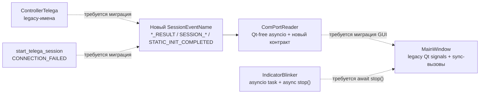
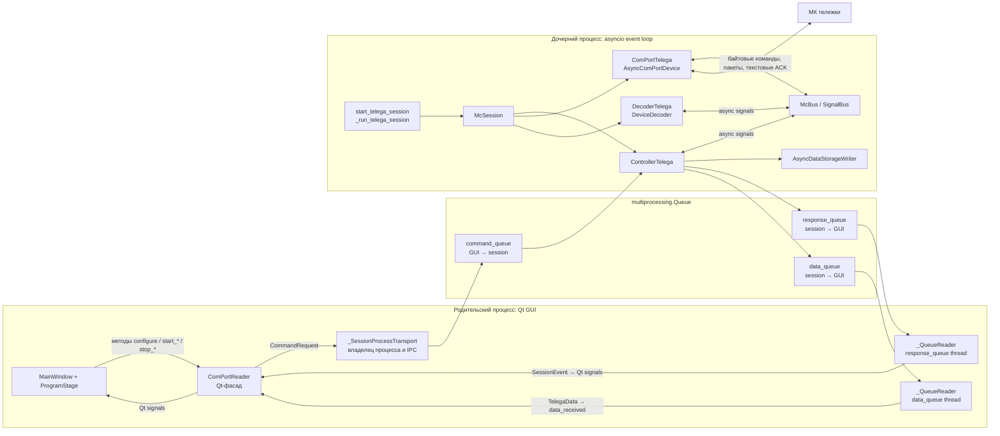
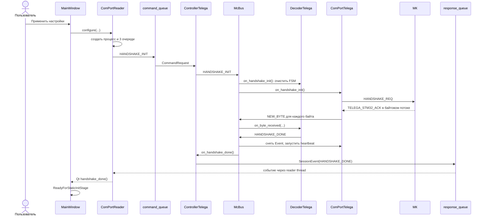
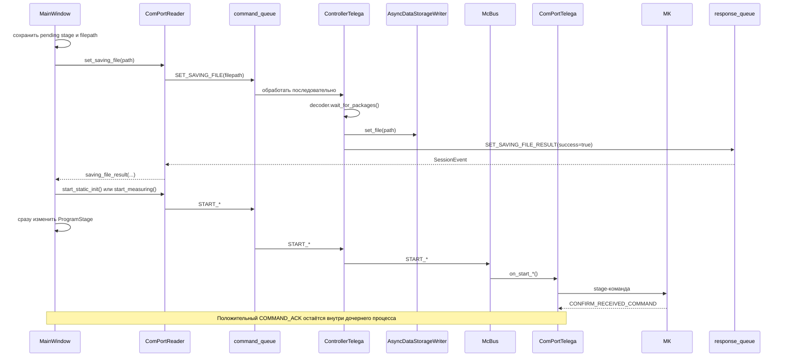
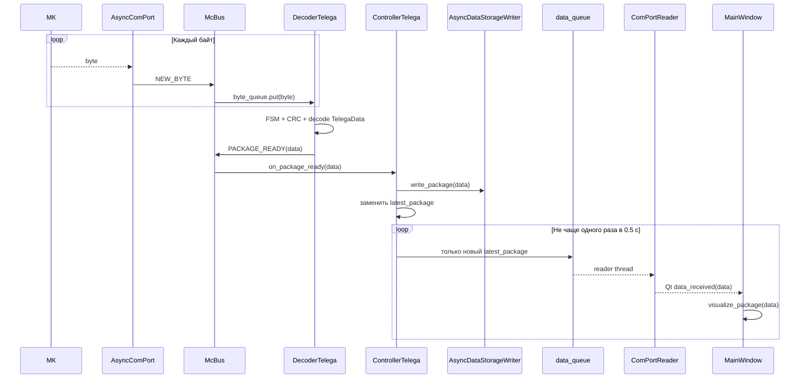
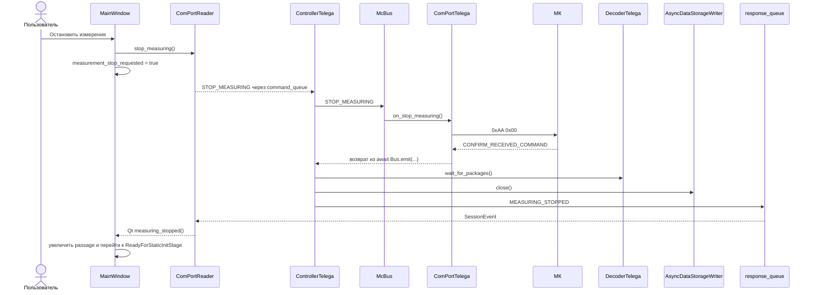
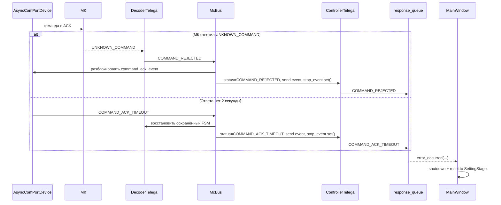
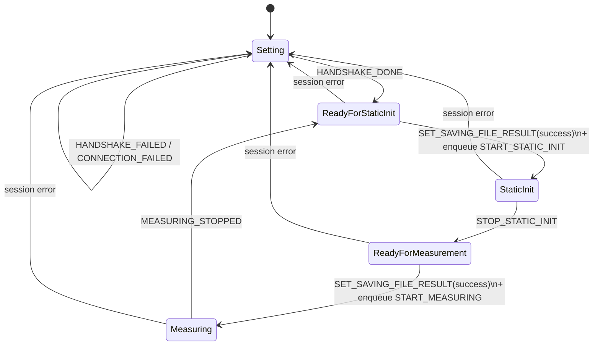

# Взаимодействие GUI, `ComPortReader` и `async_mc_controller`

> **Переходное состояние.** `SessionEventName`, `_SessionProcessTransport`,
> `ComPortReader` и `IndicatorBlinker` уже переведены на новый Qt-free asyncio
> контракт. `ControllerTelega` и `start_telega_session` всё ещё производят
> legacy-события, а `MainWindow` всё ещё ожидает Qt-сигналы и синхронные методы
> старого фасада. Поэтому Python GUI временно несовместим до миграции соседних
> слоёв. Полный план и целевой граф находятся в
> `SESSION_EVENT_ASYNC_MIGRATION.md`. `ComPortSettings` также является обычным
> Python-классом без наследования от `QObject`; логика его Qt-виджетов не
> изменена. Остальные схемы ниже описывают последнюю целостную реализацию до
> переходных изменений.

## Граф переходного состояния контракта



## Назначение документа

Этот файл — поддерживаемая карта взаимодействия Python-части проекта при работе с МК. Он описывает текущую реализацию отправки команд, подтверждений от МК, событий завершения операций, потока измерительных данных, аварий и освобождения ресурсов.

Основные точки входа:

- `gui/main_window.py` — пользовательский сценарий и стадии GUI;
- `gui/com_port_reader.py` — Qt-фасад, дочерний процесс и IPC;
- `telega_session/` — адаптация общего контроллера к протоколу тележки;
- `async_mc_controller/` — COM-порт, декодер, асинхронная шина и жизненный цикл сессии.

### Правило сопровождения

Перед изменением взаимодействия GUI с МК следует свериться с этим файлом. После изменения команд, событий, очередей, Qt-сигналов, подписок `McBus`, стадий GUI или порядка запуска/остановки нужно одновременно актуализировать:

1. общую схему;
2. таблицу IPC-команд и событий;
3. таблицу сигналов `McBus`;
4. затронутые sequence-диаграммы;
5. раздел с инвариантами и известными особенностями.

Документ описывает фактическое состояние кода, а не желаемую архитектуру.

## Краткая модель

GUI и асинхронная работа с МК выполняются в разных процессах:

- родительский процесс содержит Qt GUI, `ComPortReader` и два Python-потока чтения IPC;
- дочерний процесс содержит отдельный `asyncio` event loop, `ControllerTelega`, `ComPortTelega`, `DecoderTelega` и `McBus`;
- процессы связаны тремя `multiprocessing.Queue`;
- внутри дочернего процесса компоненты связаны типизированной асинхронной publish/subscribe-шиной `McBus`;
- МК отвечает текстовыми сообщениями протокола, которые декодер преобразует во внутренние сигналы.

Главное различие протоколов:

- `CommandRequest` и `SessionEvent` — межпроцессный протокол GUI ↔ сессия;
- `Signals`/`McBus` — внутрипроцессный протокол асинхронных компонентов;
- байтовые команды и текстовые ACK — протокол ПК ↔ МК;
- Qt-сигналы — доставка результата из транспортного слоя в главное окно.

## Общая схема



## Ответственность компонентов

| Компонент | Ответственность | Чего компонент не делает |
|---|---|---|
| `MainWindow` | Обрабатывает действия пользователя, хранит стадию сценария, ожидаемые результаты подготовки файла, показывает данные и ошибки | Не знает о `asyncio`, IPC и байтовом протоколе |
| `ProgramStage` и наследники | Разрешают или запрещают действие пользователя в текущей стадии | Не подтверждают фактическое состояние МК |
| `ComPortReader` | Даёт GUI синхронный API и Qt-сигналы, преобразует `SessionEvent` в предметные сигналы | Не реализует протокол МК и не управляет порядком стадий |
| `_SessionProcessTransport` | Создаёт процесс и три очереди, отправляет `CommandRequest`, читает результаты, освобождает IPC | Не интерпретирует бизнес-смысл событий |
| `_QueueReader` | В отдельном Python-потоке опрашивает одну IPC-очередь и передаёт элементы обработчику | Не использует `asyncio`, не хранит сценарий |
| `start_telega_session` | Создаёт event loop и компоненты конкретной сессии тележки | Не принимает решения GUI |
| `McSession` | Гарантирует порядок входа и выхода контекстных менеджеров | Не маршрутизирует команды |
| `ControllerTelega` | Читает IPC-команды, переводит их в сигналы шины, пишет CSV, публикует данные и события GUI | Не отправляет байты непосредственно в COM-порт |
| `ComPortTelega` | Сопоставляет команды стадий с байтовыми командами тележки | Не сообщает GUI об успешном ACK напрямую |
| `AsyncComPortDevice` | Сериализует запросы к МК, ждёт ACK, ведёт handshake и heartbeat | Не знает о GUI и IPC-моделях |
| `DecoderTelega` | Разбирает поток, распознаёт данные и текстовые ответы тележки | Не меняет стадии GUI |
| `McBus`/`SignalBus` | Последовательно доставляет асинхронные сигналы подписчикам | Не создаёт отдельные задачи для обработчиков и не изолирует их исключения |

## Границы выполнения

### Родительский процесс

Основной Qt-поток выполняет `MainWindow`, `ComPortReader` и вызовы его публичного API. `_SessionProcessTransport` создаёт два daemon-потока:

- читатель `response_queue`;
- читатель `data_queue`.

Каждый читатель вызывает `Queue.get(timeout=0.1)`. Полученный объект валидируется транспортом, после чего эмиттится Qt-сигнал. Обработчики `MainWindow` выполняются через механизм доставки Qt-сигналов в контекст GUI.

### Дочерний процесс

Процесс создаётся через multiprocessing-контекст `spawn`. В нём создаётся новый event loop, а `McSession` входит в компоненты строго в порядке:

1. `DecoderTelega.__aenter__()`;
2. `ComPortTelega.__aenter__()` — здесь открывается COM-порт;
3. `ControllerTelega.__aenter__()` — здесь запускается чтение `command_queue`.

Выход выполняется в обратном порядке:

1. `ControllerTelega.__aexit__()`;
2. `ComPortTelega.__aexit__()`;
3. `DecoderTelega.__aexit__()`.

Этот порядок существенен: при завершении контроллер ещё может отправить `STOP_EXECUTING`, пока COM-порт и декодер активны.

## Межпроцессный протокол

### Команда GUI → дочерняя сессия

Команда представлена Pydantic-моделью `CommandRequest`:

```text
{
    "command": CommandName,
    "params": dict[str, Any]
}
```

Дополнительные поля запрещены. Перед помещением в `command_queue` модель преобразуется через `model_dump()`. В дочернем процессе она заново валидируется через `model_validate()`.

Команды читает единственная задача `ControllerTelega._reading_command_queue()`. Она получает элемент через `asyncio.to_thread(queue.get, timeout=0.1)` и полностью ожидает обработчик текущей команды перед чтением следующей. Поэтому команды внутри сессии обрабатываются последовательно.

Некорректная команда только записывается в журнал и отбрасывается. Отдельного IPC-события об ошибке валидации или неизвестной команде нет.

### Событие дочерняя сессия → GUI

Событие представлено Pydantic-моделью `SessionEvent`:

```text
{
    "event": SessionEventName,
    "params": dict[str, Any]
}
```

`ControllerTelega` кладёт `model_dump()` в `response_queue`. Родительский транспорт валидирует объект и передаёт `SessionEvent` в `ComPortReader._session_event_handler()`. Фасад преобразует его в предметный Qt-сигнал.

### Измерительные данные дочерняя сессия → GUI

`TelegaData` передаётся отдельной `data_queue` без преобразования в словарь. Родитель проверяет `isinstance(package_data, TelegaData)`, после чего эмиттит `data_received`.

`response_queue` и `data_queue` читают разные потоки. FIFO сохраняется внутри каждой очереди, но общего порядка между событием и пакетом из разных очередей нет.

## Команды и видимый результат

| `CommandName` | Инициатор в GUI | Действие `ControllerTelega` | Работа с МК | Как GUI узнаёт результат |
|---|---|---|---|---|
| `HANDSHAKE_INIT` | `ComPortReader.configure()` автоматически после запуска процесса | Эмиттит `HANDSHAKE_INIT` | Декодер очищает FSM; порт отправляет `HANDSHAKE_REQ` и ждёт `TELEGA_STM32_ACK` | `HANDSHAKE_DONE` либо `HANDSHAKE_FAILED` |
| `SET_SAVING_FILE` | Перед каждым static init или measuring | Дожидается пакетов декодера и открывает/меняет CSV | Команда на МК не отправляется | Всегда ожидается `SET_SAVING_FILE_RESULT` с `success`, `filepath`, опциональным `error_info` |
| `START_STATIC_INIT` | После успешного `SET_SAVING_FILE_RESULT` | Эмиттит `START_STATIC_INIT` | Порт отправляет stage-команду `0xAA 0x03` и ждёт ACK | Успешный ACK отдельно не передаётся; завершение этапа приходит как `STOP_STATIC_INIT` после сообщения МК `END_OF_STATIC_INIT` |
| `START_MEASURING` | После успешного `SET_SAVING_FILE_RESULT` | Эмиттит `START_MEASURING` | Порт отправляет stage-команду `0xAA 0x02` и ждёт ACK | Успешный ACK отдельно не передаётся; GUI переводит себя в `MeasuringStage` сразу после постановки команды в IPC |
| `STOP_MEASURING` | Кнопка остановки в `MeasuringStage` | Эмиттит `STOP_MEASURING`, затем дожидается пакетов и закрывает CSV | Порт отправляет stage-команду `0xAA 0x00` и ждёт ACK | После закрытия файла отправляется `MEASURING_STOPPED` |
| `STOP_RUNNING` | `shutdown()` или явный `stop_running()` | Устанавливает `_stop_event`, из-за чего `running()` завершается | При штатном выходе контроллер эмиттит `STOP_EXECUTING`; `ComPortTelega` отправляет `0xAA 0x00` с ACK | Специального `SessionEvent` успеха нет; родитель ждёт завершения процесса, освобождает IPC и эмиттит Qt `finished` |

### Что именно означает «команда выполнена»

В текущей реализации нет единого ответа на каждую IPC-команду и нет `command_id` для корреляции запроса с ответом. Используются три разных вида подтверждения:

1. **Протокольный ACK от МК.** Сообщение `CONFIRM_RECEIVED_COMMAND` снимает ожидание в `AsyncComPortDevice._send_command_with_ack()`. Успех остаётся внутри дочернего процесса и не публикуется в GUI.
2. **Предметное событие завершения.** Например, `END_OF_STATIC_INIT` превращается в `STOP_STATIC_INIT`, а закрытие CSV после stop — в `MEASURING_STOPPED`.
3. **Подтверждение жизненным циклом.** Для `STOP_RUNNING` успешность определяется завершением процесса и очисткой ресурсов.

Следствие: `START_STATIC_INIT` и `START_MEASURING` не имеют отдельного положительного ответа GUI о принятии команды МК. Главное окно меняет стадию сразу после вызова `ComPortReader.start_*()`, то есть после успешной постановки `CommandRequest` в очередь, но до получения ACK от МК.

## Преобразование `SessionEvent` в Qt-сигналы

| `SessionEventName` | Qt-сигнал `ComPortReader` | Обработчик/эффект в `MainWindow` |
|---|---|---|
| `HANDSHAKE_DONE` | `handshake_done()` | Переход `SettingStage → ReadyForStaticInitStage` |
| `HANDSHAKE_FAILED` | `handshake_failed()` | Аварийное завершение сессии и возврат к настройкам |
| `CONNECTION_FAILED` | `connection_failed(str)` | Аварийное завершение; сообщение об ошибке открытия/запуска сессии |
| `SET_SAVING_FILE_RESULT` | `saving_file_result(bool, str, str)` | Проверка ожидаемого файла; при успехе отправка `START_STATIC_INIT` или `START_MEASURING` |
| `STOP_STATIC_INIT` | `static_init_done()` | Переход `StaticInitStage → ReadyForMeasurementStage` |
| `MEASURING_STOPPED` | `measuring_stopped()` | Сброс флага stop, увеличение номера проезда, переход к static init |
| `UNKNOWN_ERROR` | `error_occurred(str)` | Общая аварийная остановка |
| `READ_ERROR` | `error_occurred(str)` | Общая аварийная остановка |
| `DEVICE_LOST` | `error_occurred(str)` | Общая аварийная остановка |
| `COMMAND_ACK_TIMEOUT` | `error_occurred(str)` | Общая аварийная остановка |
| `COMMAND_REJECTED` | `error_occurred(str)` | Общая аварийная остановка |
| `STORAGE_ERROR` | `error_occurred(str)` | Общая аварийная остановка; `error_info` добавляется в текст |

События неизвестного типа фасад только журналирует. Ошибочное содержимое `SessionEvent` превращается в транспортный `error_occurred` ещё до предметной маршрутизации.

## Внутренняя шина `McBus`

`McBus` — типизированная оболочка над `SignalBus`. `SignalBus.emit()` ожидает подписчиков последовательно в порядке подписки. Обработчики выполняются в той же asyncio-задаче, которая эмиттит сигнал. Исключение одного обработчика прекращает доставку оставшимся подписчикам и поднимается вызывающему коду.

| Сигнал | Эмиттер | Подписчики в текущей сессии | Назначение |
|---|---|---|---|
| `NEW_BYTE` | `AsyncComPortDevice` | `DecoderTelega` | Положить байт во внутреннюю очередь декодера |
| `PACKAGE_READY` | `DeviceDecoder` | `ControllerTelega` | Записать каждый пакет в CSV и обновить последний пакет для GUI |
| `HANDSHAKE_INIT` | `ControllerTelega` | `DecoderTelega`, затем `ComPortTelega` | Очистить FSM, отправить handshake и дождаться ответа |
| `HANDSHAKE_DONE` | `DeviceDecoder` | `ComPortTelega`, затем `ControllerTelega` | Снять ожидание handshake/запустить heartbeat и сообщить GUI |
| `HANDSHAKE_FAILED` | `AsyncComPortDevice` | `ControllerTelega` | Сообщить GUI, установить аварийный статус и завершить `running()` |
| `HEARTBEAT_SENT` | `AsyncComPortDevice` | `DecoderTelega` | Сохранить состояние FSM перед коротким ответом |
| `HEARTBEAT_ACK` | `DeviceDecoder` | `ComPortTelega` | Снять ожидание heartbeat |
| `DEVICE_LOST` | `AsyncComPortDevice` | `ControllerTelega` | Сообщить GUI и завершить сессию |
| `COMMAND_SENT` | `AsyncComPortDevice` | `DecoderTelega` | Сохранить состояние FSM перед ACK команды |
| `COMMAND_ACK` | `DeviceDecoder` | `ComPortTelega` | Снять ожидание команды; в GUI не передаётся |
| `COMMAND_REJECTED` | `DeviceDecoder` | `ComPortTelega`, затем `ControllerTelega` | Снять ожидание, сообщить GUI и завершить сессию |
| `COMMAND_ACK_TIMEOUT` | `AsyncComPortDevice` | `DecoderTelega`, затем `ControllerTelega` | Восстановить FSM, сообщить GUI и завершить сессию |
| `START_STATIC_INIT` | `ControllerTelega` | `ComPortTelega` | Отправить `0xAA 0x03` с ожиданием ACK |
| `STOP_STATIC_INIT` | `DecoderTelega` | `ControllerTelega` | Закрыть CSV и отправить предметное событие GUI |
| `START_MEASURING` | `ControllerTelega` | `ComPortTelega` | Отправить `0xAA 0x02` с ожиданием ACK |
| `STOP_MEASURING` | `ControllerTelega` | `ComPortTelega` | Отправить `0xAA 0x00` с ожиданием ACK |
| `STOP_EXECUTING` | `ControllerTelega.__aexit__()` | `ComPortTelega` | Штатно перевести МК в нейтральную стадию и остановить COM-задачи |
| `INTERRUPT_MEASURING` | `ControllerTelega.__aexit__()` | `ComPortTelega` | Аварийно остановить heartbeat и разблокировать ожидание команды |
| `READ_ERROR` | `AsyncComPortDevice` | `ControllerTelega` | Сообщить GUI и завершить сессию |

Примечание: базовая задача `Controller._checking_force_stop_flag_task`, которая могла бы эмиттить `INTERRUPT_MEASURING` во время работы, сейчас не запускается. `ControllerTelega` подписывается на `INTERRUPT_MEASURING`, но отписывается до собственной эмиссии этого сигнала в `__aexit__()`. Поэтому его `on_interrupt_measuring()` в текущем штатном маршруте фактически не вызывается.

## Последовательности выполнения

### Запуск сессии и handshake



При таймауте порт эмиттит `HANDSHAKE_FAILED`; `ControllerTelega` кладёт одноимённое событие в `response_queue`, устанавливает аварийный статус и `_stop_event`.

### Подготовка файла и запуск стадии



### Поток измерительных данных



CSV получает каждый `PACKAGE_READY`, а GUI — только последний изменившийся пакет за интервал 0.5 секунды. Поток визуализации намеренно прореживается и не должен использоваться как полный журнал измерений.

### Остановка измерений



### Авария команды МК



## Стадии GUI



`ProgramStage` защищает пользовательский сценарий от недопустимых кнопочных действий. Это состояние GUI, а не подтверждённое состояние МК. Особенно важно, что переходы в `StaticInit` и `Measuring` выполняются после отправки IPC-команды, а не после положительного `COMMAND_ACK`.

## Handshake, heartbeat и ACK на уровне МК

`AsyncComPortDevice` использует один `_request_lock` для handshake, heartbeat и stage-команд. Одновременно может выполняться только один обмен «запрос → ответ». Это предотвращает конкуренцию за состояние декодера и `asyncio.Event`.

Перед heartbeat или обычной командой порт эмиттит `HEARTBEAT_SENT`/`COMMAND_SENT`. `DeviceDecoder` сохраняет состояние FSM, очищает текущий разбор до `WantHeader`, принимает короткий текстовый ACK и затем восстанавливает FSM. При таймауте команды FSM также восстанавливается через `COMMAND_ACK_TIMEOUT`.

Используемые ответы МК:

| Сообщение МК | Внутренний сигнал | Результат |
|---|---|---|
| `TELEGA_STM32_ACK` | `HANDSHAKE_DONE` | Handshake успешен, запускается heartbeat |
| `TELEGA_STM32_ALIVE` | `HEARTBEAT_ACK` | Устройство считается доступным |
| `CONFIRM_RECEIVED_COMMAND` | `COMMAND_ACK` | Ожидание текущей stage-команды завершается успешно |
| `UNKNOWN_COMMAND` | `COMMAND_REJECTED` | Ожидание снимается, сессия аварийно завершается |
| `END_OF_STATIC_INIT` | `STOP_STATIC_INIT` | Закрывается CSV static init и уведомляется GUI |

Таймаут handshake, heartbeat и обычной команды равен 2 секундам. Heartbeat запускается после handshake и выполняется каждые 10 секунд.

## Жизненный цикл и завершение

### Штатная остановка

`ComPortReader.shutdown()` блокирует вызывающий поток и выполняет:

1. постановку `STOP_RUNNING` в `command_queue`, если процесс активен;
2. ожидание процесса до 3 секунд;
3. `terminate()`, затем при необходимости `kill()`, если процесс не завершился;
4. остановку двух потоков чтения очередей;
5. закрытие и `join_thread()` всех трёх очередей;
6. закрытие дескриптора процесса;
7. эмиссию Qt `finished`.

В дочернем процессе `STOP_RUNNING` устанавливает `_stop_event`. Выход из `ControllerTelega.running()` запускает обратный выход `McSession`. При статусе `SUCCESS` контроллер сначала эмиттит `STOP_EXECUTING`, чтобы тележка перешла в stage `0xAA 0x00`; затем эмиттится `INTERRUPT_MEASURING`, закрывается CSV, останавливаются writer, COM-порт и декодер.

### Аварийная остановка

Обработчики `READ_ERROR`, `HANDSHAKE_FAILED`, `DEVICE_LOST`, `COMMAND_ACK_TIMEOUT`, `COMMAND_REJECTED` и ошибки хранилища:

1. устанавливают код/состояние ошибки;
2. отправляют `SessionEvent` в GUI;
3. устанавливают `_stop_event`;
4. вызывают выход `McSession`;
5. GUI, получив ошибку, вызывает блокирующий `shutdown()` и возвращает интерфейс к стадии настроек.

`CONNECTION_FAILED` создаётся верхним `except Exception` в `_run_telega_session()`. Поэтому фактически это событие означает исключение при входе или работе `McSession`, а не только ошибку открытия COM-порта.

## Инварианты текущей реализации

1. В дочернем процессе должна существовать одна активная сессия тележки с одним `McBus`.
2. IPC-команды обрабатываются строго по одной; следующий элемент очереди не читается до завершения текущего обработчика.
3. Запросы к МК, ожидающие ответ, сериализованы `_request_lock`.
4. Положительный `COMMAND_ACK` не пересекает границу процесса.
5. Для начала static init и measuring CSV должен быть успешно открыт заранее.
6. Перед закрытием CSV вызывается `DecoderTelega.wait_for_packages()`.
7. Полный поток пакетов сохраняется через writer; GUI-поток прорежен до одного последнего пакета за 0.5 секунды.
8. События и данные идут через разные очереди, поэтому их взаимный порядок не гарантируется.
9. `finished` означает завершённую очистку транспорта родительским процессом, а не просто самопроизвольное завершение дочернего процесса.
10. `ComPortReader._is_configured` становится `True` после запуска процесса и отправки handshake, до его успешного завершения.

## Известные особенности и зоны внимания

Это не список автоматически требуемых исправлений; изменения архитектуры нужно предварительно согласовать.

### Нет общей корреляции команд и результатов

`CommandRequest`/`SessionEvent` не содержат идентификатора запроса. GUI сопоставляет только `SET_SAVING_FILE_RESULT` по ожидаемому пути и локальным полям `_pending_saving_stage`/`_pending_saving_file`. Другие события считаются относящимися к текущей стадии.

### Стадия GUI опережает подтверждение МК

После `start_static_init()` и `start_measuring()` главное окно сразу меняет `ProgramStage`. Ошибка ACK придёт позднее отдельным аварийным событием. Это допустимо как optimistic UI, но не является строгим подтверждением старта тележки.

### Ошибка ACK не прерывает обработчик stage-команды исключением

При `COMMAND_REJECTED` событие `_command_ack_event` выставляется, а при `COMMAND_ACK_TIMEOUT` метод после эмиссии ошибки возвращается без исключения. Поэтому ожидающий обработчик `START_*`, `STOP_MEASURING` или `STOP_EXECUTING` продолжает выполнение после того, как `ControllerTelega` уже отправил аварийное событие и установил `_stop_event`.

Особенно для `STOP_MEASURING` текущий код после ошибки ACK может всё равно закрыть CSV и отправить `MEASURING_STOPPED`. В `response_queue` тогда могут последовательно оказаться аварийное событие и событие штатного завершения. При изменениях этого пути нужно решить, должен ли результат ACK возвращаться вызывающему коду явно.

### Глобальное состояние `McBus` внутри процесса

`McBus._signal_bus` и `McBus._logger` — атрибуты класса. Несколько экземпляров `McBus` в одном процессе разделят подписчиков и логгер. Текущий сценарий создаёт один экземпляр на дочерний процесс, поэтому инвариант не нарушается.

### `SignalBus.emit()` не изолирует подписчиков

Подписчики вызываются последовательно. Медленный обработчик задерживает эмиттера, а исключение прекращает доставку последующим подписчикам. Порядок подписки имеет протокольное значение, например:

- `HANDSHAKE_DONE`: сначала порт снимает ожидание, затем контроллер уведомляет GUI;
- `COMMAND_REJECTED`: сначала порт разблокирует ожидание, затем контроллер завершает сессию;
- `COMMAND_ACK_TIMEOUT`: сначала декодер восстанавливает FSM, затем контроллер завершает сессию.

### Самопроизвольное завершение процесса не очищает транспорт автоматически

Потоки `_QueueReader` прекращают работу, когда процесс уже не активен и очередь пуста, но сам дескриптор процесса и IPC-очереди остаются во владении транспорта до `shutdown()` или следующего `start()`. Qt `finished` эмиттится только после явной очистки.

### `shutdown()` блокирует GUI-поток

Главное окно вызывает `ComPortReader.shutdown()` синхронно. Нормально это занимает время штатного выхода, включая финальную задержку дочерней сессии; в худшем случае используются таймаут, `terminate()` и `kill()`.

### Широкая семантика `CONNECTION_FAILED`

Верхний перехват `Exception` в `_run_telega_session()` маркирует как `CONNECTION_FAILED` любое исключение, вышедшее за контекстный менеджер. Название события уже, чем фактическая область ошибок.

## Карта исходников

| Область | Файл |
|---|---|
| GUI и переходы стадий | `gui/main_window.py` |
| Контракты стадий | `gui/program_stages/*.py` |
| Qt-фасад, процесс и IPC readers | `gui/com_port_reader.py` |
| IPC-команды | `telega_session/command_name.py`, `telega_session/command_request.py` |
| IPC-события | `telega_session/session_event_name.py`, `telega_session/session_event.py` |
| Точка входа дочерней сессии | `telega_session/start_telega_session.py` |
| IPC-контроллер тележки | `telega_session/controller_telega.py` |
| Байтовые stage-команды | `telega_session/com_port_telega.py` |
| Конкретный протокол декодирования | `telega_session/decoder_telega.py` |
| Порядок контекстных менеджеров | `async_mc_controller/async_mc_session/mc_session.py` |
| Базовый контроллер | `async_mc_controller/controller/controller.py` |
| Асинхронный COM-порт | `async_mc_controller/byte_source/com_port/com_port.py` |
| Handshake, heartbeat и ACK | `async_mc_controller/byte_source/com_port/com_port_device.py` |
| Базовый FSM декодера | `async_mc_controller/decoding/base_decoder.py` |
| ACK и сохранение FSM | `async_mc_controller/decoding/device_decoder.py` |
| Список внутренних сигналов | `async_mc_controller/signal_bus/signals.py` |
| Типизированный API шины | `async_mc_controller/signal_bus/mc_bus.py` |
| Механика publish/subscribe | `async_mc_controller/signal_bus/signal_bus.py` |

## Чек-лист при будущих изменениях

- Если добавлена IPC-команда: обновить `CommandName`, dispatch-таблицу `ControllerTelega`, публичный API `ComPortReader`, вызывающую стадию GUI и таблицу команд здесь.
- Если GUI должен ждать результат: определить отдельный `SessionEvent`, его параметры, Qt-сигнал и правило корреляции.
- Если добавлена команда МК: определить байтовый пакет, решить нужен ли ACK, и проверить взаимодействие с `_request_lock` и сохранением FSM.
- Если добавлен `McBus`-сигнал: обновить `Signals`, протокол подписчика, typed-wrapper `McBus`, подписку/отписку и таблицу маршрутов здесь.
- Если меняется порядок подписки: проверить последовательную семантику `SignalBus.emit()`.
- Если меняется стадия GUI: обновить state diagram и указать, какое фактическое событие подтверждает переход.
- Если меняется остановка: проверить штатный `STOP_RUNNING`, аварийный путь, закрытие CSV, остановку heartbeat/reading tasks и очистку родительских IPC-ресурсов.
- Если меняется поток данных: отдельно проверить полный путь CSV и прореженный путь визуализации.
