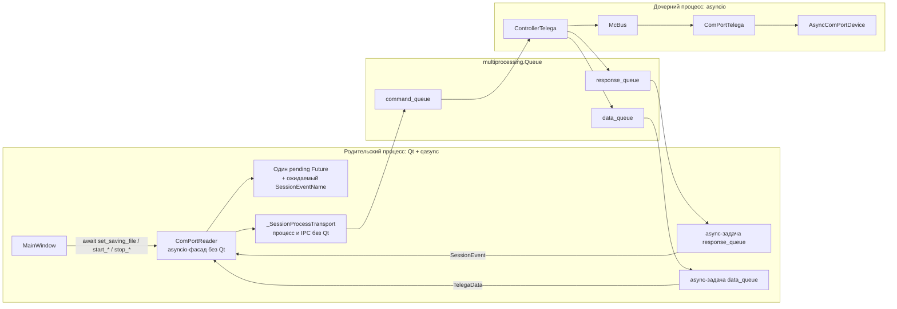

# План миграции `SessionEvent` и `ComPortReader` на asyncio

## Назначение и текущий статус

Документ фиксирует согласованную целевую архитектуру межпроцессных команд и
ответов. Он является планом будущих изменений, а не описанием уже работающей
реализации.

На текущем переходном этапе:

- `SessionEventName` уже содержит только новый контракт событий;
- `_SessionProcessTransport` и `ComPortReader` уже переведены на Qt-free asyncio
  API и новый контракт событий;
- ручной `_QueueReader`, Python-потоки чтения IPC и Qt-сигналы из
  `com_port_reader.py` удалены;
- `IndicatorBlinker` уже переведён с `QThread` на задачу asyncio в GUI loop;
- `ControllerTelega` и `start_telega_session` всё ещё используют удалённые
  legacy-имена;
- `MainWindow` всё ещё подключается к удалённым сигналам `ComPortReader`, вызывает
  его coroutine без `await` и синхронно вызывает новый async
  `IndicatorBlinker.stop()`;
- текущий путь GUI ↔ дочерняя сессия остаётся несовместим до миграции обоих
  соседних слоёв;
- `ComPortSettings` больше не наследуется от `QObject`, но по-прежнему работает
  с Qt-виджетами и их сигналами;
- механизм `MainWindow`, `ProgramStage`, `ControllerTelega` и
  `async_mc_controller` на этом этапе не изменён.

## Согласованные архитектурные правила

1. В `ComPortReader` одновременно может ожидаться результат только одной
   команды во всей сессии.
2. Каждая команда, кроме специальной команды завершения `STOP_RUNNING`, должна
   породить ровно один терминальный `SessionEvent` вида `*_RESULT`.
3. Следующая команда отправляется только после получения терминального результата
   предыдущей.
4. Для ожидания результата используется один `asyncio.Future`, а не набор
   `asyncio.Event` и отдельных полей с результатами.
5. Таймаут, отмена ожидания или несовпадающий тип результата делают сессию
   рассинхронизированной. После этого она закрывается и не используется повторно.
6. `SESSION_ERROR` завершает ожидающий `Future` исключением и запускает аварийное
   завершение сессии.
7. Самостоятельные события, например `STATIC_INIT_COMPLETED`, обрабатываются
   отдельно и не завершают командный `Future`.
8. `request_id` в `CommandRequest` и `SessionEvent` не используется, пока
   сохраняется инвариант одной незавершённой команды.
9. `ControllerTelega` является единственной границей, формирующей предметные
   результаты команд для родительского процесса. Ошибка открытия или запуска
   сессии формируется в `start_telega_session`, поскольку контроллер в этот
   момент может ещё не существовать.

## Целевая схема



## Новый контракт `SessionEventName`

### Терминальные результаты команд

| Событие | Команда | Момент отправки | Обязательные параметры |
|---|---|---|---|
| `HANDSHAKE_INIT_RESULT` | `HANDSHAKE_INIT` | Handshake завершён либо признан неуспешным | `success: bool`, `error_info: str` |
| `SET_SAVING_FILE_RESULT` | `SET_SAVING_FILE` | CSV-файл подготовлен либо подготовка завершилась ошибкой | `success: bool`, `error_info: str`, `filepath: str` |
| `START_STATIC_INIT_RESULT` | `START_STATIC_INIT` | МК подтвердил или отклонил переход в статический режим | `success: bool`, `error_info: str` |
| `START_MEASURING_RESULT` | `START_MEASURING` | МК подтвердил или отклонил переход в режим измерений | `success: bool`, `error_info: str` |
| `STOP_MEASURING_RESULT` | `STOP_MEASURING` | МК подтвердил остановку, ожидающие пакеты обработаны и CSV закрыт либо один из этапов завершился ошибкой | `success: bool`, `error_info: str` |

`error_info` должен присутствовать всегда. При успехе используется пустая строка.
Каждая команда отправляет ровно один результат независимо от успеха или ошибки.

### Самостоятельные события

| Событие | Семантика | Параметры |
|---|---|---|
| `STATIC_INIT_COMPLETED` | МК завершил статический набор, пакеты обработаны и CSV закрыт | Пустой словарь либо согласованные позднее метаданные набора |
| `SESSION_ERROR` | Фатальная ошибка вне обычного результата команды | `error_code`, `error_info: str` |
| `SESSION_STOPPED` | Дочерняя сессия полностью завершила штатную очистку | Пустой словарь |

Для `SESSION_ERROR` следует создать отдельный строковый enum, например
`SessionErrorCode`, со значениями:

- `CONNECTION_FAILED`;
- `READ_ERROR`;
- `DEVICE_LOST`;
- `STORAGE_ERROR`;
- `UNKNOWN_ERROR`.

Ошибки `COMMAND_ACK_TIMEOUT` и `COMMAND_REJECTED` не должны оставаться
самостоятельными IPC-событиями. Они преобразуются в отрицательный `*_RESULT`
текущей команды. Если такая ошибка также аварийно завершает сессию, нельзя
дублировать пользовательскую ошибку двумя конкурирующими терминальными
результатами.

## Замена legacy-событий

| Legacy-событие | Новый результат |
|---|---|
| `HANDSHAKE_DONE` | `HANDSHAKE_INIT_RESULT(success=True)` |
| `HANDSHAKE_FAILED` | `HANDSHAKE_INIT_RESULT(success=False)` |
| `STOP_STATIC_INIT` | `STATIC_INIT_COMPLETED` |
| `MEASURING_STOPPED` | `STOP_MEASURING_RESULT` |
| `CONNECTION_FAILED` | `SESSION_ERROR(error_code=CONNECTION_FAILED)` |
| `READ_ERROR` | `SESSION_ERROR(error_code=READ_ERROR)` |
| `DEVICE_LOST` | `SESSION_ERROR(error_code=DEVICE_LOST)` |
| `STORAGE_ERROR` | отрицательный результат активной команды либо `SESSION_ERROR(STORAGE_ERROR)` во время записи |
| `UNKNOWN_ERROR` | `SESSION_ERROR(error_code=UNKNOWN_ERROR)` |
| `COMMAND_ACK_TIMEOUT` | отрицательный результат активной команды |
| `COMMAND_REJECTED` | отрицательный результат активной команды |

## Изменения в `_SessionProcessTransport`

Этот этап выполнен в `gui/com_port_reader.py`:

1. Удалены наследование от `QObject` и все `pyqtSignal`.
2. Удалены `_QueueReader` и создаваемые вручную Python-потоки чтения.
3. Транспорт оставлен владельцем дочернего процесса и трёх
   `multiprocessing.Queue`.
4. Реализованы awaitable-методы получения элементов через блокирующий
   `Queue.get(timeout=0.1)`, вынесенный в `asyncio.to_thread()`.
5. Таймаут пустой очереди отделён от `EOFError`, `OSError` и `ValueError`.
6. `Queue.put()` команды также вынесен в `asyncio.to_thread()`.
7. Сохранён multiprocessing-контекст `spawn`.
8. Ожидание процесса и закрытие очередей вынесены из event loop. Штатный stop,
   `terminate()` и `kill()` сохранили прежнюю последовательность.

## Изменения в `ComPortReader`

### Удаление Qt-слоя

Этот этап выполнен:

1. Удалено наследование от `QObject`.
2. Удалены предметные `pyqtSignal` и подключения к сигналам транспорта.
3. В `com_port_reader.py` больше нет импортов Qt.
4. `response_queue` и `data_queue` читают две долгоживущие async-задачи.
5. Ссылки на задачи хранятся в `ComPortReader`; ошибки публикуются через
   отдельную локальную `asyncio.Queue`.
6. Самостоятельные `SessionEvent` и последний пакет данных публикуются через
   отдельные локальные `asyncio.Queue`.

### Ожидание результата команды

Реализованное минимальное состояние:

```python
self._pending_result: Optional[asyncio.Future[SessionEvent]]
self._expected_result_event: Optional[SessionEventName]
```

Перед отправкой команды:

1. Проверить, что `_pending_result is None`.
2. Создать новый `Future` в текущем event loop.
3. Записать ожидаемый `SessionEventName`.
4. Только после этого поместить `CommandRequest` в очередь, чтобы быстрый ответ
   не обогнал регистрацию ожидания.
5. Ожидать `Future` с согласованным таймаутом.
6. В `finally` очистить pending-состояние.

При получении терминального результата:

1. Убедиться, что ожидающий `Future` существует.
2. Проверить точное совпадение `session_event.event` и
   `_expected_result_event`.
3. Вызвать `future.set_result(session_event)` только один раз.
4. Не использовать самостоятельные события для завершения этого `Future`.

При `SESSION_ERROR` ожидающий `Future` завершается типизированным исключением.
При таймауте, отмене либо несовпадающем результате дальнейшие команды запрещены,
а сессия закрывается. Это обязательная компенсация отсутствия `request_id`.

### Реализованный публичный API

Методы стали awaitable:

```python
await com_port_reader.configure(...)
await com_port_reader.set_saving_file(file_path)
await com_port_reader.start_static_init()
await com_port_reader.start_measuring()
await com_port_reader.stop_measuring()
await com_port_reader.close()
```

На переходном этапе command-методы возвращают валидированный `SessionEvent`.
Отрицательный `success` не преобразуется в исключение автоматически. Ошибками
считаются транспортный сбой, нарушение IPC-контракта, `SESSION_ERROR`, локальный
таймаут и отмена ожидания.

До миграции `MainWindow` нужно окончательно согласовать публичную политику
предметных ошибок:

- возвращать типизированный `CommandResult`; либо
- при `success=False` возбуждать предметное исключение, а при успехе возвращать
  полезное значение или `None`.

Для async API предпочтительнее предметные исключения, но текущее возвращение
`SessionEvent` намеренно не фиксирует это решение преждевременно.

## Изменения в `IndicatorBlinker`

Выполнено:

1. Удалены `QThread`, `pyqtSignal`, принудительный `terminate()` и ручное
   дробление сна на интервалы.
2. `start()` создаёт одну контролируемую задачу `asyncio`.
3. Цикл напрямую меняет `QCheckBox` и ожидает период через `asyncio.sleep()`.
4. `stop()` стал coroutine, отменяет задачу и дожидается её завершения.
5. `IndicatorBlinker` должен запускаться внутри того же qasync loop, в котором
   работает GUI. Текущий синхронный вызов из `MainWindow` подлежит миграции.

## Изменения в `ControllerTelega`

1. Обработчик каждой IPC-команды должен сформировать ровно один терминальный
   `SessionEvent`.
2. `SET_SAVING_FILE` уже близок к требуемому контракту; нужно сделать
   `error_info` обязательной строкой.
3. Handshake должен свести `HANDSHAKE_DONE` и `HANDSHAKE_FAILED` в один
   `HANDSHAKE_INIT_RESULT`.
4. Успешный ACK команд `START_STATIC_INIT`, `START_MEASURING` и
   `STOP_MEASURING` должен стать доступен контроллеру.
5. `START_STATIC_INIT_RESULT(success=True)` отправляется после подтверждённого
   переключения МК, а `STATIC_INIT_COMPLETED` — позже, после фактического
   завершения набора и закрытия CSV.
6. `STOP_MEASURING_RESULT(success=True)` отправляется только после ACK МК,
   обработки оставшихся пакетов и успешного закрытия CSV.
7. Ошибка отсутствующего хранилища при `START_*` должна возвращаться как
   отрицательный результат команды, а не как несвязанный `STORAGE_ERROR`.
8. `STOP_RUNNING` остаётся специальной командой: родитель ожидает завершение
   процесса, а не обычный командный `Future`.

## Необходимое изменение границы ACK

Сейчас `AsyncComPortDevice._send_command_with_ack()` не сообщает вызывающему
коду, чем закончилось ожидание: положительным ACK, `COMMAND_REJECTED`, таймаутом
или прерыванием. Поэтому `ControllerTelega` не может корректно сформировать
`START_*_RESULT` и `STOP_MEASURING_RESULT`.

Перед реализацией требуется согласовать один из вариантов:

1. `_send_command_with_ack()` возвращает типизированный результат, который
   доходит от `ComPortTelega` до `ControllerTelega`;
2. положительный и отрицательный исходы публикуются отдельным предметным
   сигналом шины для текущей последовательной команды;
3. неуспешные исходы возбуждают типизированные исключения, а нормальный возврат
   означает положительный ACK.

Предпочтителен третий вариант как наиболее естественный для async-вызова, но
он затрагивает общий `async_mc_controller` и должен быть отдельно подтверждён.

## Изменения в GUI и qasync

1. Добавить и зафиксировать совместимую с используемой версией Python
   зависимость qasync.
2. Запускать Qt через qasync event loop.
3. Сделать обработчики кнопок async-совместимыми.
4. Перевести методы `ProgramStage`, которые запускают операции сессии, на
   согласованный async-контракт либо создавать контролируемые задачи на границе
   GUI.
5. Весь сценарий запуска измерений разместить внутри одной coroutine:

```python
await self._com_port_reader.set_saving_file(file_path)
await self._com_port_reader.start_measuring()
```

6. Переходить в стадию `Measuring` только после успешного
   `START_MEASURING_RESULT`.
7. Для static init использовать аналогичную последовательность и переходить в
   `StaticInit` после `START_STATIC_INIT_RESULT`.
8. `STATIC_INIT_COMPLETED` переводит GUI из `StaticInit` в
   `ReadyForMeasurement` независимо от командного `Future`.
9. Не оставлять блокирующий `shutdown()` в Qt/qasync loop.

## Порядок дальнейшей миграции

1. Согласовать представление `SessionErrorCode` и публичную политику ошибок
   `ComPortReader`.
2. Согласовать механизм возврата результата ACK из `async_mc_controller`.
3. Научить `ControllerTelega` и `start_telega_session` формировать новый контракт
   событий.
4. ~~Перевести `_SessionProcessTransport` на Qt-free awaitable API очередей.~~
5. ~~Перевести `ComPortReader` на один pending `Future` и async readers.~~
6. ~~Перевести `IndicatorBlinker` с `QThread` на asyncio-задачу.~~
7. Интегрировать qasync в точке запуска GUI.
8. Перевести `MainWindow` и затронутые `ProgramStage` на последовательные
   awaitable-сценарии.
9. После восстановления согласованности выполнить отдельно разрешённые Roman'ом
   статические проверки, тесты и ручной сценарий работы с МК.
10. Обновить `GUI_COMPORT_ASYNC_MC_INTERACTION.md` так, чтобы он снова описывал
   полностью рабочую фактическую реализацию, а не переходное состояние.

## Проверки после будущей реализации

- успешный и неуспешный handshake;
- ошибка открытия COM-порта до создания `ControllerTelega`;
- успешная и неуспешная установка CSV-файла;
- ACK, rejection и timeout для `START_STATIC_INIT`;
- раздельная доставка `START_STATIC_INIT_RESULT` и
  `STATIC_INIT_COMPLETED`;
- ACK, rejection и timeout для `START_MEASURING`;
- остановка измерений с дописыванием пакетов и закрытием CSV;
- ошибка CSV во время активной записи;
- `SESSION_ERROR` при существующем pending `Future`;
- попытка второй команды во время ожидания первой;
- отмена coroutine и запрет повторного использования сессии;
- штатное и принудительное завершение дочернего процесса;
- отсутствие блокировки GUI на всех перечисленных путях.
