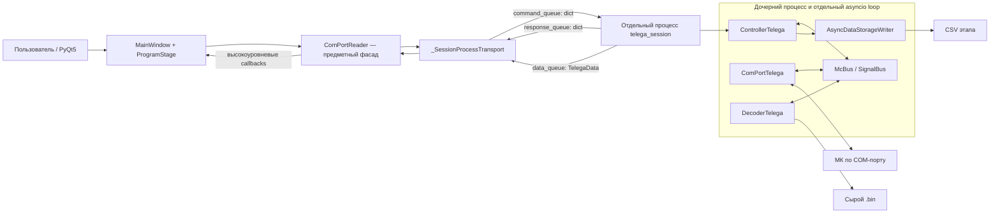

# Архитектура Python-части проекта Telega

## 1. Назначение документа

Документ описывает фактическую архитектуру каталога `Python`: границы ответственности модулей, взаимодействие GUI с отдельным процессом сессии МК, внутреннюю сигнальную шину, протокол команд и событий, приём и сохранение телеметрии, обработку ошибок и автономную постобработку результатов.

Описание основано на текущем коде. Там, где реализация содержит важное ограничение или неявную зависимость, это отмечено отдельно. Разделы 15–17 предназначены для переноса архитектуры в другие GUI-проекты управления МК и для расширения протокола новыми командами.

## 2. Основной сценарий и автономная постобработка

Основной сценарий запускается через `main.py`: это GUI-приложение управления тележкой и сбора данных.

Пакет `data_analys` предназначен для автономной офлайн-постобработки. GUI не вызывает его и не запускает постобработку автоматически. Связь между GUI и анализом файловая: приложение создаёт пары `*_static_init_N.csv` и `*_measuring_N.csv`, которые позднее находит и читает постобработка.

## 3. Общая схема GUI-приложения



Ключевая граница проходит между GUI-процессом и процессом сессии МК. GUI не знает о байтах COM-порта, сигналах ACK и деталях декодера. Дочерний процесс не зависит от Qt и не управляет виджетами.

## 4. Ответственность каталогов и модулей

| Область | Модули | Ответственность |
|---|---|---|
| Запуск GUI | `main.py` | Создание `QApplication`, объединение Qt и `asyncio` через `qasync.QEventLoop`, создание `MainWindow`. |
| GUI-координатор | `gui/main_window.py` | Компоновка компонентов, состояние пользовательского сценария, блокировка команд, формирование имён файлов, реакция на предметные результаты и ошибки. |
| Состояния GUI | `gui/program_stages/*` | Паттерн State: определяет, какие действия пользователя допустимы на каждой устойчивой стадии. |
| GUI-фасад сессии | `gui/com_port_reader.py` | Запуск дочернего процесса, владение IPC, сериализация составных операций, ожидание терминальных результатов, преобразование низкоуровневых событий в callbacks GUI. Qt не импортируется. |
| GUI-компоненты | `saving_params.py`, `com_port_settings.py`, `data_visualization.py`, `indicator_blinker.py` | Работа с отдельными группами виджетов: сохранение, выбор порта, LCD-индикаторы, индикатор активности. |
| IPC-контракт | `telega_session/command_*.py`, `session_event*.py` | Имена команд/событий и Pydantic-конверты `CommandRequest`/`SessionEvent`. |
| Сборка сессии | `telega_session/start_telega_session.py` | Точка входа дочернего процесса, создание конфигурации, логгера, шины, порта, декодера и контроллера, доставка `SESSION_ERROR`/`SESSION_STOPPED`. |
| Предметный контроллер | `telega_session/controller_telega.py` | Маршрутизация IPC-команд, координация сигналов МК, ожидание ACK, управление CSV, публикация данных GUI и формирование событий сессии. |
| Протокол COM | `telega_session/com_port_telega.py`, `packet_builders.py` | Конкретные команды тележки и формат исходящих пакетов. |
| Декодер тележки | `telega_session/decoder_telega.py` | Конкретный заголовок, форматы входящих пакетов, сообщения МК, структура `TelegaData`, запись сырого потока. |
| Сохранение данных | `telega_session/data_storage.py` | Синхронное CSV-хранилище и асинхронный пакетный писатель с ограниченной очередью. |
| Универсальная инфраструктура МК | `async_mc_controller/*` | Абстракции источника байтов, COM-порта, устройства с handshake/heartbeat/ACK, декодирующего FSM, контроллера, сессии, конфигурации и логирования. |
| Внутренняя коммуникация | `async_mc_controller/signal_bus/*` | Последовательная асинхронная publish-subscribe доставка и типизированный фасад `McBus`. |
| Конфигурация и логи GUI | `app_config/*`, `logger/*` | Pydantic-конфигурация приложения, JSON `settings.json`, отдельная иерархия логгеров GUI. |
| Офлайн-обработка | `data_analys/*` | Поиск пар файлов, загрузка, коррекции, начальная выставка, инерциальная обработка, траектория и сведение по ДПП. |
| Графики | `plotting/*` | Обёртки над Matplotlib, не связанные с GUI реального времени. |

### 4.1. Активный путь и вспомогательные части

Не весь код каталога участвует в запуске `main.py`.

- Активный путь GUI: `main.py` → `gui.MainWindow` → `ComPortReader` → `start_telega_session` → `McSession` с `DecoderTelega`, `ComPortTelega` и `ControllerTelega`.
- `AsyncComPortSetting`, `ComPortInfo` и `async_mc_controller.utils.confirm_from_console` образуют альтернативный консольный механизм выбора порта. GUI его не использует: порт выбирается через `ComPortSettings`.
- `McConfig` поддерживает самостоятельную загрузку/сохранение JSON, но в активной дочерней сессии создаётся в памяти и заполняется параметрами, переданными из GUI.
- `FooLogger` — заглушка для базовых компонентов и автономного использования; активная сессия передаёт `McLogger`.
- `_restart_command` в `ComPortTelega` определена, но ни один текущий handler её не отправляет.
- Механизм `_checking_force_stop_flag` базового `Controller` присутствует, но его задача не запускается; предметный `ControllerTelega` напрямую обрабатывает аварийные сигналы и устанавливает `_stop_event`.
- `frequency_analysis.py` имеет самостоятельный демонстрационный блок `__main__`, не связанный с GUI.
- `gui/ui/main_window.ui` и изображения — runtime-ресурсы представления; логика не генерируется из `.ui` в Python, а загружается через `loadUi`.

## 5. Механизмы разделения ответственности

### 5.1. Процессная изоляция

`ComPortReader` запускает `start_telega_session` через `multiprocessing` с контекстом `spawn`. Работа с COM-портом, декодирование, heartbeat и CSV выполняются в дочернем процессе. Это отделяет жизненный цикл оборудования от Qt и не позволяет блокирующей или аварийной операции с портом напрямую остановить GUI event loop.

В каждом процессе свой `asyncio` loop:

- в родительском процессе это общий loop Qt/`asyncio` от `qasync`;
- в дочернем процессе loop создаётся вручную в `start_telega_session`.

### 5.2. Фасад между GUI и IPC

`MainWindow` вызывает предметные методы `ComPortReader`: `configure`, `start_static_init`, `start_measuring`, `stop_measuring`, `reset`, `shutdown`. Очереди, Pydantic-модели и имена IPC-событий скрыты внутри фасада.

Обратно GUI получает только синхронные высокоуровневые callbacks из `ComPortReaderCallbacks`. Они исполняются задачами родительского event loop, поэтому обновление Qt-виджетов остаётся в GUI-потоке.

### 5.3. State для пользовательского сценария

Классы `SettingStage`, `ReadyForStaticInitStage`, `StaticInitStage`, `ReadyForMeasurementStage` и `MeasuringStage` инкапсулируют допустимость пользовательских действий. Кнопка всегда делегирует действие текущему объекту `ProgramStage`; стадия либо вызывает операцию `MainWindow`, либо показывает предметное предупреждение.

Дополнительно `MainWindow._pending_operation` временно запрещает повторную команду, пока не получен терминальный результат. Таким образом разделены:

- устойчивая стадия сценария;
- кратковременное состояние ожидания результата команды.

### 5.4. Publish-subscribe внутри процесса МК

`SignalBus` хранит асинхронные обработчики и вызывает их последовательно в порядке подписки. `McBus` даёт каждому сигналу типизированный интерфейс `subscribe`, `unsubscribe`, `emit`; ожидаемые методы подписчиков описаны `Protocol`-классами в `subscribers.py`.

Компоненты не вызывают друг друга напрямую:

- COM-порт публикует байты и ошибки;
- декодер публикует пакеты и распознанные ответы МК;
- контроллер публикует намерения начать/остановить режим;
- порт преобразует эти намерения в команды проводного протокола.

### 5.5. Template Method и наследование протокола

Универсальные классы задают жизненный цикл и алгоритмический каркас:

- `AsyncBytesSource` — контракт источника;
- `AsyncComPort` — открытие, чтение и закрытие последовательного порта;
- `AsyncComPortDevice` — handshake, heartbeat, сериализация запросов и ожидание ACK;
- `BaseDecoder[T]` — конечный автомат кадра и очереди обработки;
- `DeviceDecoder[T]` — стандартные сообщения устройства и сохранение состояния FSM на время ACK;
- `Controller` — базовые подписки на аварийные сигналы;
- `McSession` — единый порядок входа/выхода компонентов.

Предметные наследники `ComPortTelega`, `DecoderTelega` и `ControllerTelega` задают конкретный протокол тележки.

### 5.6. Отдельный асинхронный владелец CSV

`ControllerTelega` не пишет CSV самостоятельно. Он передаёт пакеты `AsyncDataStorageWriter`, у которого одна фоновая задача последовательно пишет пачки до 64 пакетов либо накапливает их не более 20 мс. Ограниченная очередь на 2048 элементов создаёт обратное давление и ограничивает рост памяти.

## 6. Межпроцессный контракт

Создаются три `multiprocessing.Queue`.

| Очередь | Направление | Содержимое | Назначение |
|---|---|---|---|
| `command_queue` | GUI → сессия | `CommandRequest.model_dump()` | Команда и словарь параметров. |
| `response_queue` | сессия → GUI | `SessionEvent.model_dump()` | Терминальный результат команды или автономное событие сессии. |
| `data_queue` | сессия → GUI | `TelegaData` | Последний пакет телеметрии для отображения. |

Конверты команд и событий запрещают лишние поля (`extra='forbid'`), но содержимое `params: dict[str, Any]` валидируется вручную обработчиком конкретной команды.

Текущие команды:

- `STOP_RUNNING`;
- `HANDSHAKE_INIT`;
- `SET_SAVING_FILE`;
- `START_STATIC_INIT`;
- `START_MEASURING`;
- `STOP_MEASURING`.

Для всех команд, кроме служебной `STOP_RUNNING`, ожидается одно парное терминальное событие `*_RESULT` с обязательными полями `success: bool` и `error_info: str`. `SET_SAVING_FILE_RESULT` дополнительно содержит `filepath: str`.

Автономные события:

- `STATIC_INIT_COMPLETED` — МК самостоятельно завершил статический набор, а CSV уже закрыт;
- `SESSION_ERROR` — фатальная ошибка дочерней сессии;
- `SESSION_STOPPED` — дочерняя сессия завершилась.

В протоколе нет идентификатора команды. Корректность обеспечивается строгим правилом «не более одной ожидающей команды»: по одному `Future` существует в `ComPortReader` и `ControllerTelega`.

## 7. Внутренняя сигнальная шина

| Сигнал | Издатель | Основной подписчик | Смысл |
|---|---|---|---|
| `NEW_BYTE` | `AsyncComPortDevice` | `DeviceDecoder` | Один байт из COM-порта. |
| `PACKAGE_READY` | `DeviceDecoder` | `ControllerTelega` | Готовый пакет телеметрии. |
| `ENABLE_PACKAGE_PUBLISHING` | `ControllerTelega` | `DeviceDecoder` | Разрешить передачу декодированной телеметрии после подготовки CSV. |
| `DRAIN_PACKAGES` | `ControllerTelega` | `DeviceDecoder` | Запретить новые пакеты и дождаться уже декодированных. |
| `HANDSHAKE_INIT` | `ControllerTelega` | декодер, затем порт | Очистить FSM, отправить запрос handshake и дождаться ответа. |
| `HANDSHAKE_DONE` | декодер | порт, контроллер | Разблокировать ожидание порта и завершить командный `Future`. |
| `HANDSHAKE_FAILED` | порт | контроллер | Таймаут handshake. |
| `START_STATIC_INIT` | контроллер | `ComPortTelega` | Отправить команду режима статического набора. |
| `START_MEASURING` | контроллер | `ComPortTelega` | Отправить команду режима измерения. |
| `STOP_MEASURING` | контроллер | `ComPortTelega` | Отправить команду выхода из измерения. |
| `STOP_STATIC_INIT` | `DecoderTelega` | контроллер | Получено `END_OF_STATIC_INIT`; закрыть CSV и уведомить GUI. |
| `COMMAND_SENT` | порт | декодер | Сохранить FSM перед ожиданием короткого ACK. |
| `COMMAND_ACK` | декодер | порт, контроллер | Подтвердить проводную команду. |
| `COMMAND_REJECTED` | декодер | порт, контроллер | МК прислал `UNKNOWN_COMMAND`. |
| `COMMAND_ACK_TIMEOUT` | порт | декодер, контроллер | Восстановить FSM и завершить команду ошибкой. |
| `HEARTBEAT_SENT` | порт | декодер | Сохранить FSM перед heartbeat. |
| `HEARTBEAT_ACK` | декодер | порт | Подтвердить heartbeat и восстановить FSM. |
| `DEVICE_LOST` | порт | контроллер | Нет heartbeat ACK. |
| `READ_ERROR` | порт | контроллер | Ошибка физического чтения. |
| `STOP_EXECUTING` | контроллер | порт | Штатно остановить heartbeat и чтение. |
| `INTERRUPT_MEASURING` | контроллер | порт | Аварийно прекратить протокольное взаимодействие. |

Доставка последовательная. Исключение обработчика прекращает доставку оставшимся подписчикам. Порядок подписки поэтому является частью фактической семантики: например, при ACK сначала освобождается ожидание порта, затем завершается `Future` контроллера.

## 8. Проводной протокол ПК ↔ МК

### 8.1. Формат кадра

Построители используют структуру:

```text
[2 байта заголовка] [1 байт формата] [1 байт длины тела] [тело] [1 байт checksum]
```

Checksum — сумма всех предыдущих байтов кадра по модулю 256. Максимальная длина тела — 255 байт.

Исходящие кадры ПК имеют заголовок `E7 7E` и формат команды `AB`. Входящие кадры МК декодируются с заголовком `7E E7`; формат данных — `C8`, формат ASCII-сообщения — `CD`. Асимметрия заголовков является частью текущего протокола.

### 8.2. Команды ПК

- `HANDSHAKE_REQ` и `HEARTBEAT_REQ` передаются как ASCII-тело;
- `AA 00` — переход в нейтральную стадию;
- `AA 02` — запуск измерений;
- `AA 03` — запуск статического набора;
- `FF FF` подготовлена как команда перезапуска, но текущий GUI-сценарий её не использует.

Обычная команда выполняется только внутри `_request_lock`, поэтому она не пересекается с heartbeat. Перед отправкой порт публикует `COMMAND_SENT`, а затем не более двух секунд ждёт один из исходов: ACK, отказ `UNKNOWN_COMMAND`, аварийное прерывание или таймаут.

### 8.3. Сообщения МК

Текущая реализация не содержит самостоятельных «команд МК» в смысле симметричного командного API. МК присылает телеметрию и ASCII-сообщения, которые декодер маршрутизирует как события:

- `TELEGA_STM32_ACK` — handshake выполнен;
- `TELEGA_STM32_ALIVE` — heartbeat подтверждён;
- `CONFIRM_RECEIVED_COMMAND` — обычная команда подтверждена;
- `UNKNOWN_COMMAND` — команда отвергнута;
- `END_OF_STATIC_INIT` — статический набор завершён по инициативе МК.

### 8.4. Телеметрия

`DecoderTelega` преобразует бинарное тело в `TelegaData`:

| Поле | Размер | Представление |
|---|---:|---|
| `package_num` | 4 байта | `uint32`, little-endian |
| `acc` | 12 байт | три `float32`, little-endian |
| `gyro` | 12 байт | три `float32`, little-endian |
| `temp` | 4 байта | `float32`, little-endian |
| `dpp_code` | 4 байта | `int32`, little-endian |

## 9. Жизненный цикл приложения и сессии

### 9.1. Запуск

1. `main.py` создаёт общий Qt/`asyncio` loop.
2. `MainWindow` загружает `app_config/settings.json`, настраивает `AppLogger`, загружает `.ui` и связывает виджеты.
3. Создаются GUI-компоненты, `ComPortReader`, callbacks и неизменяемые объекты стадий.
4. Начальная стадия — `SettingStage`; активна только команда применения настроек.

### 9.2. Конфигурирование и handshake

1. Пользователь нажимает «Применить».
2. `SettingStage` читает и валидирует путь, шаблон имени и COM-порт.
3. `MainWindow.configure_session` ставит `_PendingOperation.CONFIGURE`, сохраняет настройки и блокирует их редактирование.
4. Формируется абсолютный путь сырого файла `{template}.bin`.
5. `ComPortReader.configure` создаёт единственную асинхронную операцию.
6. Транспорт создаёт три очереди и дочерний процесс, затем запускает две reader-задачи родительского процесса.
7. В дочернем процессе создаются `McLogger`, `McBus`, `ComPortTelega`, `DecoderTelega`, `ControllerTelega`.
8. `McSession` входит в контексты в порядке: декодер → COM-порт → контроллер. Выход выполняется в обратном порядке.
9. `HANDSHAKE_INIT` очищает декодер, порт посылает `HANDSHAKE_REQ` и ждёт `TELEGA_STM32_ACK` до двух секунд.
10. Контроллер преобразует внутренний исход в `HANDSHAKE_INIT_RESULT`.
11. `ComPortReader` ждёт результат до пяти секунд, помечает сессию настроенной и вызывает `on_handshake_done`.
12. `MainWindow` снимает pending-маркер и переходит в `ReadyForStaticInitStage`.

### 9.3. Запуск статического набора

1. `MainWindow` формирует `{template}_static_init_{N}.csv` и ставит pending-маркер.
2. `ComPortReader` последовательно выполняет две IPC-команды: `SET_SAVING_FILE`, затем `START_STATIC_INIT`.
3. Дочерний контроллер осушает старую очередь CSV и открывает новый файл с перезаписью.
4. Публикация телеметрии разрешается, порт посылает `AA 03` и ждёт общий ACK.
5. После `START_STATIC_INIT_RESULT(success=True)` GUI переходит в `StaticInitStage`.

### 9.4. Завершение статического набора по команде МК

1. МК присылает `END_OF_STATIC_INIT`.
2. `DecoderTelega` публикует `STOP_STATIC_INIT`.
3. `ControllerTelega` запрещает публикацию новых пакетов, ждёт опустошения очереди декодера и очереди CSV, закрывает файл.
4. Только после закрытия файла отправляется `STATIC_INIT_COMPLETED`.
5. `ComPortReader` вызывает `on_static_init_completed` без участия ожидающего командного `Future`.
6. GUI переходит в `ReadyForMeasurementStage`.

### 9.5. Запуск и остановка измерений

Запуск аналогичен статическому набору: сначала подготавливается `{template}_measuring_{N}.csv`, затем команда `AA 02` подтверждается общим ACK. После терминального результата GUI переходит в `MeasuringStage`.

При остановке:

1. GUI отправляет `STOP_MEASURING`.
2. Порт посылает `AA 00` и ждёт ACK.
3. После ACK контроллер осушает декодер и CSV-писатель, закрывает файл.
4. Только после этого отправляется `STOP_MEASURING_RESULT(success=True)`.
5. GUI увеличивает номер проезда и возвращается в `ReadyForStaticInitStage`.

### 9.6. Heartbeat

После успешного handshake порт запускает heartbeat-задачу. Раз в десять секунд она захватывает общий `_request_lock`, публикует `HEARTBEAT_SENT`, отправляет `HEARTBEAT_REQ` и до двух секунд ждёт `TELEGA_STM32_ALIVE`. Таймаут превращается в `DEVICE_LOST` и фатальное событие сессии.

### 9.7. Закрытие приложения

1. Первое Qt-событие закрытия скрывает окно и создаёт `_shutdown_and_close`; немедленное закрытие отклоняется.
2. GUI ждёт уже запущенный аварийный reset, затем вызывает `ComPortReader.shutdown`.
3. Транспорт пытается отправить `STOP_RUNNING`, ждёт процесс до трёх секунд, затем при необходимости применяет `terminate`, после него `kill`.
4. При штатном выходе контроллер останавливает фоновые задачи, посылает `STOP_EXECUTING`, закрывает CSV и писатель.
5. Порт и декодер освобождаются; сырой `.bin` закрывается.
6. Дочерний процесс отправляет `SESSION_STOPPED`; родитель закрывает очереди и reader-задачи.
7. Повторное Qt-событие закрытия принимается.

## 10. Поток телеметрии и сохранение

Путь каждого входящего байта:

```text
COM StreamReader
→ AsyncComPort._reading_loop
→ NEW_BYTE
→ DecoderTelega.on_byte_received
→ синхронная запись байта в raw .bin
→ _byte_queue
→ BaseDecoder FSM + checksum
→ TelegaData
→ _package_queue (только когда публикация разрешена)
→ PACKAGE_READY
→ ControllerTelega
→ AsyncDataStorageWriter
→ CSV
```

Сырой `.bin` содержит весь входной поток с момента открытия сессии, включая управляющие ответы между измерительными этапами. CSV содержит только корректные пакеты данных, декодированные при разрешённой публикации.

В GUI передаётся не каждый пакет. Контроллер хранит только последний и не чаще одного раза в 0,5 секунды помещает новую версию в `data_queue`. Это отделяет частоту записи данных от частоты перерисовки интерфейса: CSV рассчитан на полный поток, GUI — примерно на 2 Гц.

CSV имеет пробельный разделитель и поля:

```text
PackageNum DppCode AccX AccY AccZ GyroX GyroY GyroZ Temp
```

## 11. Модель ошибок и восстановление

### 11.1. Ошибки, допускающие повтор операции

- неверный `ComPortSessionConfig`;
- неверный локальный путь CSV;
- невозможность подготовить CSV по `SET_SAVING_FILE`;
- попытка начать вторую операцию до завершения первой.

Они имеют `fatal_error=False`. GUI снимает pending-маркер и остаётся в текущей устойчивой стадии. После ошибки конфигурирования поля настроек разблокируются.

### 11.2. Фатальные ошибки

- дочерний процесс не запущен или неожиданно завершился;
- таймаут терминального IPC-результата;
- отрицательный результат handshake или проводной команды;
- нарушение порядка/формы IPC-событий;
- `SESSION_ERROR` от дочерней сессии;
- ошибка COM-чтения, потеря heartbeat, таймаут ACK, отказ команды МК;
- фоновая ошибка записи CSV.

`ComPortReader` помечает сессию ненастроенной и доставляет одну предметную ошибку GUI. `MainWindow` блокирует команды, выполняет `reset`, освобождает процесс и очереди, очищает визуализацию, разблокирует настройки и возвращается в `SettingStage`.

Ошибки фоновых reader-задач либо завершают текущий ожидающий `Future`, либо передаются GUI напрямую, если команды в этот момент нет. `_background_error` предотвращает повторную доставку одной ошибки.

## 12. Конфигурация и логирование

`AppConfig` хранит настройки GUI: `ComPortConfig`, `save_dir`, `LoggerConfig`. Файл `app_config/settings.json` создаётся при первом `AppConfig.load`, неизвестные ключи запрещены.

Для GUI используется `AppLogger` с иерархией `AppLogger.*`. Для дочернего процесса создаётся отдельный `McLogger` с иерархией логгеров компонентов. Перед запуском процесса конфигурация логгера копируется, а имена файлов логов задаются отдельно.

`LoggerProtocol` и `FooLogger` позволяют базовым компонентам принимать логгер по структурному контракту, хотя основной сценарий использует конкретные фабрики логгеров.

## 13. Офлайн-постобработка и графики

`data_analys` — отдельный последовательный pipeline:

```text
discover_run_files
→ load_run_csv
→ apply_sensor_corrections
→ initialize_from_static_buffer
→ process_inertial_data
→ compute_trajectory
→ detect_direction_from_dpp / aggregate_by_dpp
→ сохранение результатов
→ сведение нескольких проездов по DppCode
```

Ответственность этапов:

- `file_discovery.py` сопоставляет пары файлов по общему префиксу и номеру проезда;
- `data_loader.py` проверяет обязательные колонки, строит время по `PackageNum`, переводит гироскоп из mdps в rad/s;
- `sensor_correction.py` резервирует точки расширения для температурной компенсации и фильтрации; сейчас обе функции возвращают данные без изменения;
- `initialization.py` оценивает ориентацию body→ENU, смещения датчиков, гравитацию и вращение Земли по статическому буферу;
- `inertial.py` интегрирует ориентацию и переводит ускорение в ENU;
- `trajectory.py` интегрирует ускорение в скорость и координату и линейно корректирует конечные условия;
- `dpp_axis.py` определяет направление, усредняет отсчёты по `DppCode`, объединяет проезды и опционально прореживает результат;
- `models.py` содержит dataclass-модели входов, конфигурации и результатов;
- `math_tools` содержит предметные `Vector` и `Quaternion`;
- `plotting` отделяет конфигурацию графика (`CanvasConfig`), низкоуровневый Matplotlib canvas (`Canvas`) и типовые графики (`Plotter`).

## 14. Сильные стороны и ограничения текущей реализации

### 14.1. Сильные стороны

- Qt, IPC и проводной протокол разделены фасадом; GUI не зависит от деталей байтового обмена.
- COM-сессия изолирована отдельным процессом с отдельным event loop.
- Жизненный цикл ресурсов централизован `McSession` и асинхронными контекстными менеджерами.
- Внутренние компоненты слабо связаны через сигнальную шину.
- Команды сериализованы на трёх уровнях: GUI pending-маркер, один operation task фасада и один `Future` контроллера.
- Терминальный успех остановки означает не только ACK МК, но и фактическое закрытие CSV.
- Полный поток записи отделён от прореженного потока визуализации.
- Писатель CSV имеет одну задачу, пакетную запись, ограниченную очередь и явное осушение.
- Есть единая цепочка фатального восстановления до стадии настройки.

### 14.2. Ограничения, которые нельзя переносить неосознанно

1. `McBus._signal_bus` и `_logger` — атрибуты класса. Все экземпляры `McBus` внутри одного процесса разделяют подписчиков и логгер. Текущий дизайн безопасен только потому, что дочерний процесс создаёт одну сессию. Параллельные сессии в одном процессе будут пересекаться.
2. Порядок последовательной доставки сигналов и порядок подписки фактически входят в протокол, но не выражены отдельным контрактом. Ошибка одного подписчика блокирует следующих.
3. IPC не имеет `command_id`/correlation ID и поддерживает только одну команду в полёте. Расширение до параллельных команд потребует изменения контракта, а не добавления ещё одного `Future`.
4. `params: dict[str, Any]` не имеет отдельных типизированных схем для каждой команды и события. Ошибки формы параметров обнаруживаются поздно и вручную.
5. `ControllerTelega` не имеет явной предметной state machine этапов. Корректный порядок в основном гарантирует GUI; прямой клиент `command_queue` может отправить логически несвоевременную команду.
6. `MainWindowProtocol` не полностью изолирует стадии: `SettingStage` обращается к приватным `_saving_params` и `_com_port_settings` главного окна.
7. «Универсальный» пакет `async_mc_controller.byte_source.com_port.__init__` экспортирует Telega-специфичные packet builders, поэтому граница универсального слоя нарушена обратной зависимостью от `telega_session`.
8. Запись каждого сырого байта в `.bin` выполняется синхронно в event loop декодера. При медленном носителе это может увеличить задержки обработки.
9. `multiprocessing.Queue` для IPC создаются без ограничения размера. `data_queue` получает данные только с частотой около 2 Гц, но для долгих блокировок GUI предел памяти не задан.
10. Ошибка помещения события или пакета в IPC-очередь только логируется дочерним процессом. Родитель обычно обнаружит проблему позднее по таймауту.
11. Таймауты заданы константами в разных слоях: 2 секунды для ответа МК, 5 секунд для IPC-команды, 3 секунды для остановки процесса. Они не входят в конфигурацию сессии.
12. Температурная компенсация и фильтрация объявлены в конфигурации постобработки, но пока являются no-op. Включённый флаг создаёт ложное ожидание фактической коррекции.

## 15. Инструкция по миграции в другой GUI-проект управления МК

Ниже описан перенос с сохранением текущего архитектурного подхода: GUI-процесс + дочерний процесс сессии + внутренняя сигнальная шина. Изменение этой схемы, поддержка нескольких МК или отказ от отдельного процесса являются отдельными архитектурными решениями.

### 15.1. Сначала зафиксировать контракт нового устройства

До копирования кода необходимо письменно определить:

- транспорт: COM/USB, скорость, правила открытия и закрытия;
- заголовки входящих и исходящих кадров;
- форматы, поле длины, endian, checksum/CRC;
- набор команд ПК и обязательность подтверждения каждой команды;
- отдельные виды ACK либо единый ACK;
- heartbeat: период, таймаут, ответ и поведение при потере;
- типы телеметрии и максимальную частоту;
- автономные сообщения/запросы МК;
- стадии пользовательского процесса и допустимые переходы;
- какие данные сохраняются полностью, какие отображаются с прореживанием;
- какие ошибки допускают повтор операции, а какие уничтожают сессию.

### 15.2. Разделить переносимые и предметные части

| Категория | Что делать при переносе |
|---|---|
| `AsyncBytesSource`, базовый `AsyncComPort`, `BaseDecoder`, идея `McSession`, `LoggerProtocol` | Обычно переносить как инфраструктуру после удаления Telega-зависимостей. |
| `AsyncComPortDevice`, `DeviceDecoder`, `Controller`, `SignalBus` | Переносить после проверки, что новый протокол действительно использует handshake/heartbeat/единый ACK. |
| `McBus` и `Signals` | Создать предметную версию для нового проекта. Желательно сделать хранилище подписчиков экземплярным, а не классовым. |
| `ComPortTelega`, `DecoderTelega`, `ControllerTelega`, packet builders | Заменить предметными классами нового МК. |
| `CommandName`, `SessionEventName`, модели IPC | Создать заново по операциям нового GUI. Не переносить лишние команды. |
| `ComPortReader` | Сохранить роль фасада, но переименовать и адаптировать callbacks, составные операции и таблицу результатов. |
| `ProgramStage` и стадии | Спроектировать заново по пользовательскому сценарию нового устройства. |
| `DataStorage` и `DataVisualizer` | Адаптировать к новой структуре пакета и требованиям файлов. |
| `data_analys`, `plotting` | Переносить только если совпадает предметная математика и формат результатов. |

### 15.3. Рекомендуемый порядок реализации

1. Создать отдельный пакет предметного протокола нового МК, не помещая его packet builders в универсальный пакет.
2. Описать тип пакета телеметрии и типизированные модели параметров команд/событий.
3. Реализовать и проверить чистые функции сборки/декодирования кадров отдельно от COM-порта.
4. Реализовать предметный декодер: заголовки, форматы, сообщения, поля данных.
5. Реализовать предметный COM-класс: конкретные байты команд и обработчики управляющих сигналов.
6. Создать предметную сигнальную шину и таблицу «издатель → сигнал → подписчик».
7. Реализовать контроллер дочерней сессии и его явные состояния. Контроллер должен проверять допустимость команды независимо от GUI.
8. Определить IPC-команды, парные терминальные результаты и автономные события. Для расширяемого проекта лучше сразу добавить `command_id` и отдельные Pydantic-модели параметров.
9. Собрать компоненты единственной точкой входа дочернего процесса и единым контекстным менеджером.
10. Реализовать GUI-фасад, скрывающий очереди и низкоуровневые события.
11. Спроектировать GUI State-модель и только после этого связать кнопки с предметными операциями.
12. Отдельно реализовать полное сохранение данных и ограниченный поток визуализации.
13. Определить штатное закрытие, таймаут процесса и аварийный reset до подключения реального GUI.
14. Добавить журналирование на границах: действие пользователя, отправка IPC-команды, проводная команда, ответ МК, терминальный результат, переход стадии.

### 15.4. Обязательные инварианты переносимой архитектуры

- GUI никогда не читает COM-порт и не знает байтов команд.
- Дочерний процесс никогда не изменяет Qt-виджеты.
- На каждую принятую IPC-команду приходит ровно один терминальный результат либо одно явно фатальное событие, завершающее ожидание.
- `success=True` означает завершение всей предметной операции, включая необходимый flush/close хранилища.
- Перед отправкой команды ожидание ответа регистрируется заранее, иначе быстрый ACK может быть потерян.
- Все задачи и очереди имеют одного владельца и освобождаются им же.
- При остановке сначала запрещается создание новых пакетов, затем осушаются очереди, затем закрывается файл.
- Поток GUI не должен получать телеметрию с полной частотой без явной необходимости.
- Ошибка фоновой задачи обязательно доходит до владельца сессии; одного сообщения в лог недостаточно.
- Допустимость команды проверяется и GUI, и дочерним контроллером.

### 15.5. Что улучшить при новом переносе

Без изменения общей схемы полезно сразу заложить:

- экземплярный `SignalBus` внутри `McBus`;
- `command_id` в `CommandRequest` и `SessionEvent`;
- отдельные Pydantic-модели параметров каждой команды и результата;
- явный enum состояния дочерней сессии;
- конфигурируемые таймауты и частоты;
- bounded IPC-очереди и политику переполнения;
- отдельный асинхронный писатель сырого потока;
- гарантированную доставку ошибки IPC вместо «записать в лог и продолжить»;
- интерфейсы фасада и GUI без доступа к приватным атрибутам.

## 16. Добавление новой команды пользователя

Сначала нужно определить тип команды.

### 16.1. Только локальная GUI-команда

Если действие не затрагивает дочерний процесс или МК, изменения ограничиваются GUI:

1. Добавить виджет и подключить Qt-сигнал.
2. Добавить метод в `ProgramStage` и реализовать поведение во всех стадиях: выполнить, отклонить или игнорировать.
3. Добавить публичный метод `MainWindow` и при необходимости новый `_PendingOperation`.
4. Централизованно учесть доступность кнопки в `_update_controls`.
5. Определить успешный и ошибочный переход стадии.

Не следует добавлять IPC-команду только ради единообразия, если операция полностью локальна.

### 16.2. Команда GUI → дочерняя сессия без команды МК

Пример — смена файла или локальная операция с хранилищем.

1. Добавить имя в `CommandName`.
2. Добавить парное имя `*_RESULT` в `SessionEventName`.
3. Добавить соответствие в `ComPortReader._command_result_events`.
4. Добавить публичный и приватный метод фасада; приватный метод вызывает `_execute_command`.
5. Добавить обработчик в `ControllerTelega._command_to_handler`.
6. Провалидировать параметры до изменения состояния.
7. Отправить ровно один результат с `success` и `error_info` на всех ветках.
8. Добавить callback предметного результата и обработчик `MainWindow`.
9. Если операция отражается в пользовательском сценарии, обновить стадии и `_PendingOperation`.

### 16.3. Полная команда GUI → сессия → МК с общим ACK

Для команды, которую МК подтверждает текущим `CONFIRM_RECEIVED_COMMAND`, требуется пройти все слои.

1. **GUI:** добавить кнопку/действие, поведение каждой стадии, pending-маркер и ожидаемый переход.
2. **Фасад:** добавить метод операции, `CommandName → SessionEventName`, callback успеха и обработку отрицательного результата.
3. **IPC:** добавить `CommandName.NEW_COMMAND` и `NEW_COMMAND_RESULT`.
4. **Контроллер:** добавить handler в `_command_to_handler`; до `McBus.emit` создать `_pending_command_result`; после `emit` преобразовать код результата в `SessionEvent`.
5. **Шина:** добавить `Signals.NEW_COMMAND`, протокол подписчика и descriptor в `McBus`; обновить экспорты и таблицу логируемых сигналов.
6. **COM-класс:** собрать байты команды через packet builder, подписаться в `__aenter__`, отписаться в `__aexit__`, в handler вызвать `_send_command_with_ack`.
7. **Декодер:** при сохранении единого ACK менять ничего не требуется — существующие `COMMAND_SENT`/`COMMAND_ACK` обслужат новую команду. Если формат ответа иной, использовать раздел 17.
8. **Ошибки:** явно решить, является ли отказ/таймаут фатальным. Текущий контроллер считает отрицательный результат всех проводных команд, кроме подготовки файла, фатальным.
9. **Документация и проверки:** проверить успешный ACK, `UNKNOWN_COMMAND`, таймаут, неожиданное событие, повтор результата, закрытие приложения во время ожидания.

Критически важно создать `Future` до публикации сигнала команды. `McBus.emit` выполняет обработчик порта и может дождаться очень быстрого ACK до возврата управления контроллеру.

### 16.4. Если новая команда имеет собственный ответ

Нельзя завершать её общим `COMMAND_ACK`, если ответ содержит данные или имеет другую семантику.

1. Добавить отдельное сообщение в `DecoderTelega._msg_to_handler` либо отдельный входной формат в `_fmt_to_decode_func`.
2. Добавить отдельный внутренний сигнал ответа и типизированный аргумент.
3. В порте завести отдельное ожидание либо унифицированный объект результата; не переиспользовать `Event`, если нужно передать payload.
4. В контроллере завершать командный `Future` типизированным результатом.
5. Передать payload через отдельную модель `SessionEvent.params`.
6. Валидировать payload в `ComPortReader` до callback GUI.

При появлении нескольких параллельных запросов текущая одно-командная модель недостаточна: необходимо совместно спроектировать correlation ID и таблицу ожидающих `Future`.

## 17. Добавление нового сообщения, команды или данных от МК

### 17.1. Новое автономное ASCII-сообщение МК

Для события, аналогичного `END_OF_STATIC_INIT`:

1. Добавить строковую константу в предметный декодер.
2. Зарегистрировать handler в `_msg_to_handler`.
3. Добавить внутренний `Signals.*`, протокол подписчика и descriptor `McBus`, если событие должен обрабатывать другой компонент.
4. Подписать `ControllerTelega` и реализовать handler.
5. Если событие нужно GUI, добавить автономное `SessionEventName`, отправить `SessionEvent`, маршрутизировать его в `ComPortReader._session_event_handler` и добавить callback.
6. В `MainWindow` проверить допустимую стадию до изменения UI. Неожиданное событие должно стать протокольной ошибкой либо явно игнорироваться по документированному правилу.

### 17.2. Запрос МК, на который ПК должен ответить

Текущей готовой абстракции для симметричных команд МК нет. Для такого протокола нужно добавить её явно:

1. Декодер распознаёт запрос и извлекает его payload.
2. Внутренний сигнал передаёт типизированный запрос контроллеру.
3. Контроллер проверяет состояние и принимает предметное решение.
4. Отдельный сигнал ответа передаётся COM-компоненту.
5. COM-компонент строит и отправляет ответ; если МК подтверждает ответ, применяется отдельный request/response lifecycle.
6. При необходимости GUI получает отдельное событие, но не участвует в жёстком real-time ответе, если его задержка недопустима.

Не следует обрабатывать такую команду целиком в декодере: его ответственность — распознать сообщение, а не принимать предметные решения и управлять состоянием.

### 17.3. Новый формат пакета МК

1. Добавить байт формата и async decode-функцию в `_fmt_to_decode_func`.
2. Описать отдельный тип результата, если пакет не является обычной телеметрией.
3. Проверить длину тела до извлечения полей и использовать явные функции endian-преобразования.
4. Определить маршрут: CSV, GUI, только контроллер или отдельное IPC-событие.
5. Добавить сигнал и подписчика только там, где это действительно межкомпонентная коммуникация.

### 17.4. Новое поле в телеметрии

Изменение проходит сквозь несколько контрактов:

1. `TelegaData` и индексы/размеры в `DecoderTelega`.
2. Декодирование и endian нового поля.
3. Формат строк и заголовок `DataStorage`.
4. `DataVisualizer`, если поле показывается в GUI.
5. Тип, передаваемый через `data_queue`; при `NamedTuple` оба процесса должны импортировать одинаковое определение.
6. `data_analys.data_loader`: обязательные колонки, единицы и преобразования.
7. Модели и этапы постобработки, если поле используется математически.
8. Пользовательское руководство и описание формата файлов.

После изменения формата необходимо решить совместимость старых CSV и старой прошивки. Молчаливое чтение несовместимых данных опаснее явного номера версии протокола.

## 18. Контрольный список расширения

Перед завершением любого расширения проверить:

- у команды есть ровно один терминальный исход;
- у автономного события нет ложной привязки к текущему `Future`;
- параметры валидируются на обеих сторонах IPC;
- GUI и дочерний контроллер проверяют допустимость состояния;
- подписка и отписка симметричны;
- порядок подписчиков не создаёт скрытую гонку;
- команда сериализована с heartbeat;
- таймаут освобождает сохранённое состояние декодера;
- успех остановки приходит после drain/flush/close;
- фоновая ошибка доходит до GUI ровно один раз;
- reset освобождает частично созданные ресурсы;
- новый поток данных имеет ограничение частоты или размера очереди;
- raw/CSV/GUI/offline-модели обновлены согласованно;
- лог содержит команду, ответ, результат и переход состояния.

## 19. Итоговая модель ответственности

Главный принцип текущей реализации — последовательное сужение деталей:

```text
Пользовательское действие
→ GUI State и предметная операция MainWindow
→ фасад ComPortReader
→ типизированный IPC-конверт
→ ControllerTelega
→ внутренний сигнал-намерение
→ конкретная команда ComPortTelega
→ байтовый протокол МК
```

Обратный путь также поднимает уровень абстракции:

```text
байты МК
→ конечный автомат декодера
→ типизированные данные или внутреннее событие
→ ControllerTelega
→ SessionEvent / TelegaData
→ ComPortReader
→ предметный callback
→ переход стадии и обновление GUI
```

Эту симметрию следует сохранять при расширении: каждый слой преобразует данные только в понятия соседнего слоя и не забирает ответственность более высокого или более низкого уровня.
